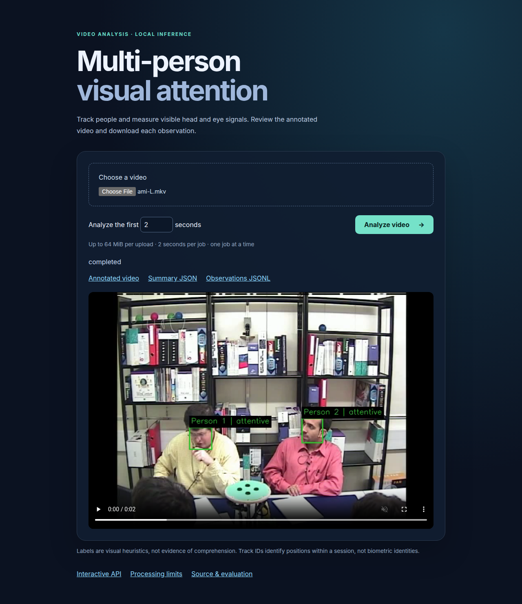
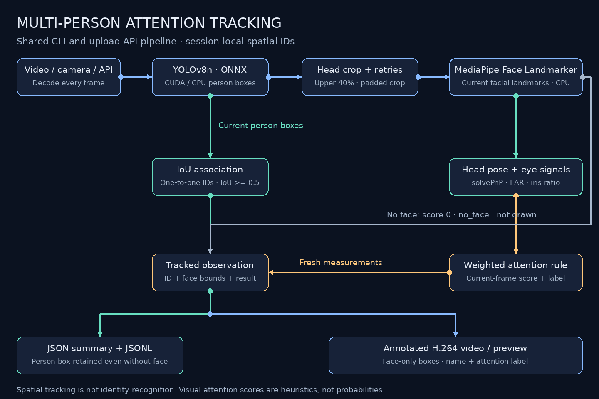
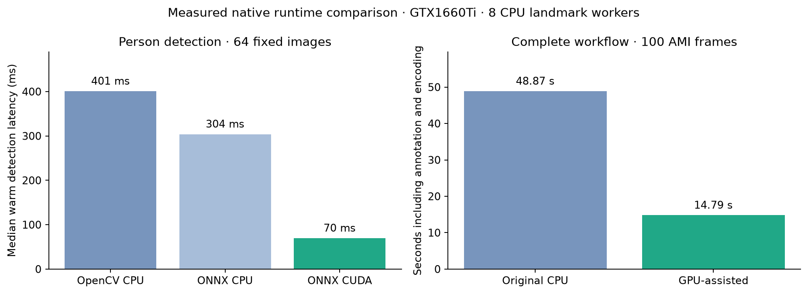
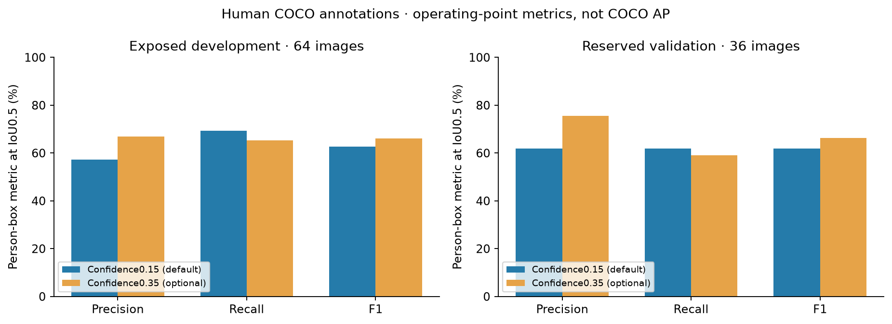

# Multi-Person Visual Attention Tracking

Analyze video or camera input with **YOLOv8n person detection**, **MediaPipe face
landmarks**, spatial tracking and an explicit head/eye score. An upload UI and
FastAPI service return annotated H.264 video, per-track summaries and frame-level
JSONL. Inference stays local; no cloud account or API key is required.

Built by **Bola Maged Ramses Nessim**.

The measured GPU-assisted route moves YOLO to ONNX Runtime CUDA while keeping
landmarks on CPU. On the same 100 AMI frames it took **14.8 s**, versus **48.9 s**
for the original OpenCV CPU route, with **identical observation JSONL**. These are
small development benchmarks, not a real-time throughput or attention-accuracy guarantee.

[Docker guide](deployment/docker/README.md) · [API guide](docs/api/README.md) ·
[CI/CD guide](docs/deployment/README.md) · [Evaluation](docs/evaluation/README.md)

## Demo and interface


The existing classroom demo shows more than ten students in one view. Source:
**AIRC-SMARTCLASS Part 2**, CC BY 4.0; excerpts were trimmed, annotated and combined.
[Attribution and modifications](docs/DEMO_SOURCE.md) · [MP4](docs/media/attention-demo.mp4).
Its prior observations remain historical; they are not the new API/GPU benchmark.



The new interface uploads a clip, plays the annotated output and links all reports.
This screenshot uses the licensed AMI fixture with a two-second test cap;
[fixture attribution](evaluation/fixtures/README.md). The service's default maximum
source duration is 10 seconds, configurable in `ServiceSettings`.

## Pipeline — inputs and outputs



[Scalable diagram](docs/media/pipeline.svg) · [Architecture](docs/ARCHITECTURE.md)

1. **Decode:** a CLI video/camera source or API upload supplies each frame.
2. **Detect:** YOLOv8n finds person boxes, using full-frame and overlapping regions.
   CUDA and ONNX CPU are optional alternatives to the original OpenCV CPU path.
3. **Measure:** CPU MediaPipe workers analyze upper-body crops, retry small or
   difficult faces, and map landmarks back to source coordinates.
4. **Associate and score:** one-to-one IoU assignment retains session-local IDs;
   head pose, eye opening, iris position and visibility drive the original weighted rule.
5. **Report:** stream observations to JSONL, write an atomic per-track summary,
   and draw face-only boxes in a browser-compatible annotated video.

Missing measurements remain `no_face`, with unknown attention and no drawn body box.
IDs are spatial tracks, not recognized identities. Labels do not measure comprehension.

## Evaluation and measured performance



| Check | Native measured result |
| --- | --- |
| Automated regressions | **41 tests passed**, lint/format and dependency checks passed |
| Person detection: 64 exposed COCO images | Precision **57.27%**, recall **69.23%**, F1 **62.69%** at IoU 0.5 |
| Person detection: 36 reserved images | Precision/recall/F1 **61.90%** at the unchanged confidence 0.15 |
| Detector median: OpenCV CPU / ONNX CPU / CUDA | **400.8 / 304.0 / 69.6 ms**, identical TP/FP/FN counts on 64 images |
| Full workflow: 100 AMI frames | **48.88 s CPU / 14.79 s GPU-assisted**, about **3.30×** faster |
| Output preservation | Both views' observation JSONL identical across original CPU and CUDA runs |
| Synthetic tracking | IDF1 **100%** on stationary, slow-motion and short-occlusion cases; **77.5%** on crossing stress, with 2 identity switches |
| Browser/API | Actual GPU upload, all 3 artifacts and H.264 playback passed; zero JavaScript errors |
| Native GPU-assisted resources | Peak process RSS **1,334 MiB**; whole-device VRAM **166 MiB**; process CPU mean **266%** (100%=one core) |



The confidence 0.35 development candidate improved F1 on the reserved 36 images
(**66.31%**) and halved false positives (**40→20**), but reduced recall
(**61.90→59.05%**). The default remains 0.15; this tradeoff is documented rather than
silently changing what gets detected. Four landmark workers reduced sampled peak
RSS to 1,128 MiB but took 15.46 s for the same 100 frames; eight workers remain the default.

These detection metrics use independent human COCO boxes, not model predictions
as truth, and are operating-point metrics rather than official COCO AP. Synthetic
tracking bypasses detection and is not real-world identity accuracy. AMI labels are
model-derived regression references, not human attention labels. The native workflow
had 633 person observations, 459 with no measurable face; this is measurement availability,
not face recall against annotations. Crowded scenes, back-facing people, occlusion
and duplicate detections remain limitations.

**[Evaluation README: datasets, split protocol, failures, stage charts and resource scope](docs/evaluation/README.md)**.
Container qualification and public-image evidence are recorded there when complete.

## API — upload, status and results

The FastAPI service exposes:

| Interface | Purpose |
| --- | --- |
| `GET /` | Upload UI with annotated playback |
| `GET /health`, `GET /config` | Model readiness, runtime/device and processing limits |
| `POST /jobs?max_seconds=2` | Upload a bounded video and start a sequential job |
| `GET /jobs/{id}` | Processing status |
| `GET /jobs/{id}/result` | Summary JSON and stage timings |
| `GET /jobs/{id}/observations` | Frame-level JSONL |
| `GET /jobs/{id}/video` | Annotated H.264 MP4 |

Open **http://localhost:8770/docs** for interactive examples. One worker keeps models
loaded and admits one upload/job at a time. Defaults bound uploads to 64 MiB, clips
to 10 seconds, resolution to 1080p and retained jobs to 10. This is a localhost single-user
service; live-camera CLI capture is separate from its file-upload HTTP contract.

**[API README: examples, formats, limits, retention and lifecycle](docs/api/README.md)**.

## Docker — complete application image

[Public Docker Hub repository](https://hub.docker.com/r/bmaged23/multi-person-attention-tracking)

The bundle includes the UI/API, CLI, pinned dependencies and both production models.
No source checkout, credentials or first-run model download is needed. The first
public release is pending exact-container qualification; do not treat native results
above as an already qualified image.

```bash
docker pull bmaged23/multi-person-attention-tracking:gpu
docker run --rm --name attention --gpus all \
  -p 127.0.0.1:8770:8770 \
  -v attention-results:/app/data \
  bmaged23/multi-person-attention-tracking:gpu
```

After initialization, open **http://localhost:8770**. Stop with Ctrl+C. Linux amd64
NVIDIA GPU containers are the primary route. CPU mode uses the same bundle with
`-e ATTENTION_PERSON_DEVICE=cpu` and without `--gpus all`; public checks cover both
modes before release completion. Results persist in the bounded named volume.

**[Docker README: requirements, direct pull/run, sample clip, CPU mode, updates and local build](deployment/docker/README.md)**.

## CI/CD — tests to verified public image

**Pinned install and offline checks → candidate image → exact-image GPU evaluation
→ quality gate → Docker Hub publication → anonymous pull and real GPU/CPU API jobs.**

Hosted runners build the image; the trusted local GPU runner checks 100 human-box
images, synthetic tracking, API jobs, decoded output videos and real Chromium
upload/playback. The same evaluated digest is copied to Hub only after passing
[frozen thresholds](evaluation/release_policy.json). Failed gates skip publication.
Public verification happens afterward and can fail without automatically rolling
back a published tag. CD delivers an image; it does not restart a user's application.

Every push/PR runs offline checks. Runtime owner pushes to `main` start the release;
docs-only updates avoid rebuilding. The GPU runner and frozen local COCO inputs
must be available. No cloud inference secret is needed.

**[CI/CD README: flowchart, jobs, triggers, failure behavior and evidence](docs/deployment/README.md)**
· [Checks](.github/workflows/checks.yml) · [Release workflow](.github/workflows/release.yml)

## Clone, install and run from source

Tested runtime: **Python 3.12.15, Linux x86-64/WSL2**. GPU measurements use a
GTX 1660 Ti with 6 GiB VRAM; landmarks use CPU. Allow several GB for exact dependencies/CUDA
libraries and use a host with sufficient RAM beyond the sampled process peak.
The public container requires additional download/unpacking headroom.

```bash
git clone https://github.com/bmaged23/multi-person-attention-tracking.git
cd multi-person-attention-tracking
python3.12 -m venv .venv
source .venv/bin/activate
python -m pip install --upgrade pip
python -m pip install --no-deps -r requirements.txt
python -m pip check
cp .env.example .env
```

On Ubuntu/WSL, install required system libraries if missing:

```bash
sudo apt-get update
sudo apt-get install -y ffmpeg libgl1 libegl1 libgles2 libgl1-mesa-dri \
  libglib2.0-0 libportaudio2 libgomp1
```

The exact 58-package snapshot includes API, CUDA inference, evaluation and development
tools. `requirements-dev.txt` references the same snapshot; PyTorch is not required.
Native Windows and macOS were not qualified by this release.

Download checksum-pinned models, then start GPU-assisted inference:

```bash
python scripts/download_model.py
python scripts/download_person_model.py
ATTENTION_PERSON_BACKEND=onnx ATTENTION_PERSON_DEVICE=cuda \
  python -m uvicorn attention_tracking.api:app \
  --host 127.0.0.1 --port 8770 --workers 1
```

Open **http://localhost:8770**. For native CPU use, run the same command without the
two environment assignments; `.env.example` preserves the original OpenCV CPU
person detector. An ONNX CPU alternative uses `PERSON_BACKEND=onnx` and
`PERSON_DEVICE=cpu`. Keep `ATTENTION_DEVICE=cpu` for the tested landmark path;
MediaPipe's optional OpenGL delegate is not implied by CUDA availability.

### CLI video and camera entry points

```bash
python video_attention.py --video evaluation/fixtures/ami-L.mkv \
  --person-backend onnx --person-device cuda \
  --output output/example.json --annotated-video output/example.mp4

python live_camera_attention.py --source 0 --display \
  --output output/camera.json --annotated-video output/camera.mp4
```

Append `--max-seconds 5` to bound source duration. Press Q in a displayed camera
session. Physical-camera/RTSP capture was not verified here; WSL requires camera
passthrough for that CLI route. A saved recording works through the upload API.

CLI output includes a summary JSON, sibling `_observations.jsonl`, and an optional
H.264/yuv420p annotation. Only current face boxes are drawn. Track names can be
supplied with `--names names.json`; they are labels for session IDs, not enrollment.

## Configuration

All settings live in [`attention_tracking/config.py`](attention_tracking/config.py).
Precedence is CLI flags → environment → root `.env` → code defaults. Restart the
API after changes. Increasing workers duplicates landmark models and can increase
RAM; it does not guarantee a speedup.

| Parameter | Default / purpose |
| --- | --- |
| Person runtime | OpenCV CPU natively; Docker defaults ONNX CUDA |
| Person tiling / confidence | 2 / 0.15 |
| Landmark workers / device | 8 independent CPU instances |
| Landmark detection / presence confidence | 0.35 / 0.25 |
| IoU threshold / track timeout | 0.5 / 1.0s |
| Head limits | yaw ±39.4°; pitch −24.6° to 41.6° |
| EAR / central iris interval | 0.092 / 0.37–0.63 |
| Head / eye / iris / visibility weights | 0.50 / 0.15 / 0.10 / 0.25 |
| Attentive / partial score thresholds | 0.50 / 0.25 |
| API concurrency / source cap | 1 / 10s |

Low EAR gives `drowsy` label priority; otherwise the weighted thresholds apply.
Unavailable signals retain their original neutral fallback. No score smoothing,
semantic attention model or behavior ground truth was added. See the
[architecture](docs/ARCHITECTURE.md), [original thresholds](docs/original_attention_defaults.json)
and [.env.example](.env.example) for detailed values and API bounds.

## Verification and reproduction

```bash
python -m unittest discover -s tests -v
ruff check .
ruff format --check attention_tracking scripts tests config.py video_attention.py live_camera_attention.py
python -m pip check

# Human annotation subsets; keep source images local:
python scripts/datasets/prepare_detection_evaluation.py
python scripts/datasets/prepare_detection_evaluation.py --subset validation
python -m scripts.evaluation.evaluate_detector --backend onnx --device cuda \
  --output .evaluation-local/detection-reproduction
python -m scripts.evaluation.evaluate_tracking \
  --output .evaluation-local/tracking-reproduction.json
```

The downloader verifies hashes against frozen references and refuses changed input
references. [Evaluation instructions](docs/evaluation/README.md) include complete
paired benchmarks, source provisioning, component scope and release evidence.
The existing classroom host returned 403 during this upgrade; public classroom
media remains preserved, and the current measurements use AMI and COCO.

## Project layout

```text
attention_tracking/
  api.py, upload_limits.py       Local service, admission and request limits
  config.py, runtime.py          Validated configuration and CUDA loading
  detection/                    Person inference and parallel head crops
  analysis/                     Original pose/eye measurements and visual score
  tracking/                     One-to-one IoU association
  video/                        Frame pipeline, annotations, encoding and reports
web/                            Upload UI, styles and playback client
scripts/
  evaluation/                   Detection, synthetic tracking and workflow profiling
  release/                      Exact-image gate, public checks and Hub overview sync
  documentation/                Charts from saved measurement JSON
  datasets/                     Optional licensed test-source provisioning
  download*_model.py            Checksum-verified model provisioning
  build*_*.py                   Existing demo/diagram generators
evaluation/datasets/            Frozen human-box references and synthetic trajectories
evaluation/fixtures/            Licensed lossless AMI API samples
evaluation/release_policy.json  Prequalification regression thresholds
deployment/docker/              Image recipe and Docker guide
deployment/dockerhub/            Public overview source
docs/api/, deployment/          Detailed API and CI/CD guides
docs/evaluation/                Methods, charts and measured aggregates
tests/                          Offline, API, geometry and association regressions
```

Private uploads/results, environments, models, input downloads, raw experimental
outputs and local `description/` notes are ignored. Historical validations retain
their original scope. The existing classroom video and animated pipeline remain available.

## Licenses and limitations

Application source: [AGPL-3.0-only](LICENSE), aligned with the packaged YOLO model's
upstream terms. Models and media retain their own licenses and attribution;
see [third-party notices](docs/THIRD_PARTY.md).

This is a visual measurement prototype. Detector misses/duplicates, unknown faces,
pose/camera geometry and crossing/occluded tracks affect outputs. It does not
recognize identities or establish learning, sleep, intent or comprehension.
