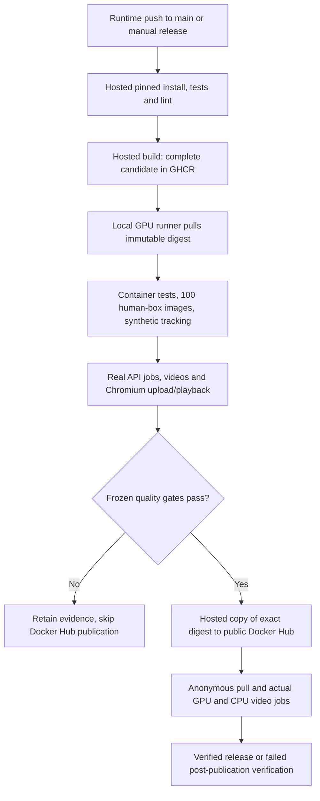

# CI/CD — evaluated image delivery

[Main README](../../README.md) · [Docker usage](../../deployment/docker/README.md) · [Evaluation](../evaluation/README.md)

## What runs where

| Job | Runner | Responsibility |
| --- | --- | --- |
| `tests` | GitHub-hosted Ubuntu | Clean pinned installation, dependency consistency, offline unit/API tests and Ruff |
| `build` | GitHub-hosted Ubuntu | Build Linux amd64 application with both production models, stage in GHCR |
| `qualify` | Trusted local `attention-gpu` | Test the exact image on real CUDA hardware with frozen local inputs; verify source revision |
| `publish` | GitHub-hosted Ubuntu | Preserve the qualified manifest digest while copying to Docker Hub `gpu` and `sha-<commit>`; synchronize overview |
| `verify_public` | Trusted local `attention-gpu` | Anonymous Hub pull and normal startup with actual API inference in both GPU and CPU modes |

Model evaluation happens **after image build and before Docker Hub publication**.
The gate checks 64 development and 36 reserved COCO images against human boxes,
four synthetic identity trajectories, two 50-frame AMI API jobs, decoded annotated
video, JSONL consistency, and a real browser upload with H.264 playback and artifact
downloads. Detection metrics, synthetic association and model-derived workflow
regressions have distinct meanings; see the
[frozen release policy](../../evaluation/release_policy.json).

## Triggers and credentials

Every push and pull request runs [Checks](../../.github/workflows/checks.yml).
Runtime changes on owner `main` pushes trigger
[Evaluated container release](../../.github/workflows/release.yml). Documentation
changes do not rebuild unchanged models. Workflow-only maintenance needs a manual
Actions → Evaluated container release → Run workflow on `main` when a new image is
needed. Releases queue rather than cancel an active run.

The laptop must be awake, Docker/WSL GPU integration working, and its registered
`attention-gpu` runner online. The runner attaches the project's pinned evaluation
environment and frozen local COCO images. AMI fixtures are tracked under their
CC-BY license. Hosted runners cannot access the laptop's GPU by themselves.
Removing local fixtures/runner prevents new GPU qualification until they are restored.

`GITHUB_TOKEN` provides scoped GHCR access. `DOCKERHUB_TOKEN` is stored as a repository
secret. Inference is entirely local; this project needs no cloud-model API key.
Pull requests have no publication credentials or trusted GPU release access.

## Failures and evidence

Failed tests, incomplete coverage, input-hash changes or quality regression skip
publication. A valid low score is not retried until it passes. The exposed
crossing-trajectory limitation stays visible with a non-regression floor; it is not
reported as perfect identity tracking. Thresholds must not be lowered to force a
candidate through. A previous model output is used only for workflow regression,
never as detection accuracy ground truth.

Aggregate gate and container resource summaries are retained as the
`attention-qualification` workflow artifact for 30 days. Detailed outputs, input
references, job artifacts and failed-run evidence are archived locally by run ID.
An execution error can happen before an aggregate exists; inspect that job's log
and private archive. Raw source images and user uploads are not public CI artifacts.

Public verification runs **after** publication and can fail the overall workflow.
It does not automatically roll back a tag already copied to Hub. CD here delivers
a verified image; it does not update a running user application or deploy a public
hosted server. Pull/run instructions are in the [Docker README](../../deployment/docker/README.md).

## Hosted media tooling

Hosted offline checks use the FFmpeg binary from pinned
[`imageio-ffmpeg==0.6.0`](https://github.com/imageio/imageio-ffmpeg/tree/v0.6.0),
installed into an isolated runner-temporary prefix. Only its executable is added
to PATH; the application's exact 58-package environment stays separate. Host GL/GLib
libraries are checked first, with bounded package installation only if missing.
This avoids an unconditional FFmpeg installation and its large system dependency
transaction on every check. Native setup and the qualified container still use
their documented system FFmpeg. All API/video tests remain enabled.
