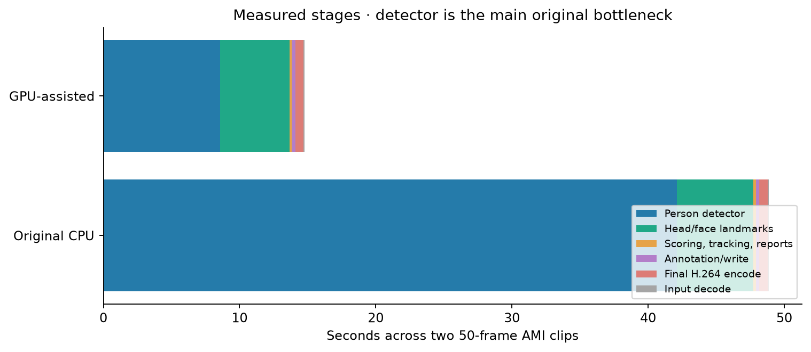
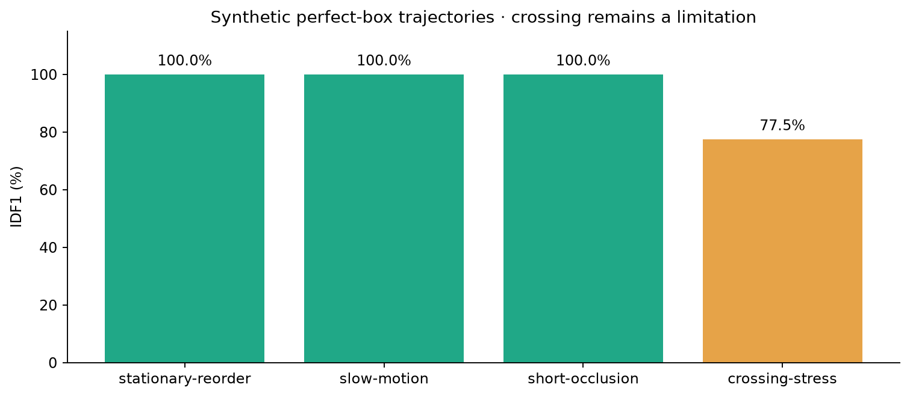

# Evaluation — models, association, workflow and performance

[Main README](../../README.md) · [Frozen policy](../../evaluation/release_policy.json) · [CI/CD](../deployment/README.md)

Measurements below are native Linux/WSL2 results on a GTX 1660 Ti with 6 GiB VRAM,
Python 3.12.15 and the exact checked-in requirements. CUDA accelerates person
inference; MediaPipe landmarks stay on CPU. No model was trained or fine-tuned.
The [current organization release](#organization-release--26-october-2026) below records separate image, resource and public-distribution evidence.

## Independent detection references

The data source is the human-annotated COCO validation split mirrored by
[detection-datasets/coco](https://huggingface.co/datasets/detection-datasets/coco),
revision `cf0b22332314a937e9dc8a1957b21725430bb41d`. Category 0 is person; the
mirror's boxes are already xyxy. Source references, dimensions and image hashes
are frozen in [`evaluation/datasets`](../../evaluation/datasets).

- Development: first 64 viewer rows, 182 person boxes, fixed before initial inference.
- Reserved validation: rows 64–99, 36 images and 105 boxes, fixed before testing the
  development-selected threshold on them. No filtering on people count or predictions.
- The confidence 0.35 candidate was selected after examining development results.
  Its validation comparison was run once; no further threshold tuning followed.
  The original 0.15 default was retained because the higher setting loses recall.

These are small, non-random subsets of a public validation split, not a pristine
benchmark independent of upstream model development. They are now exposed local
regression sets. Raw source images stay local; ground-truth boxes are human
annotations, not predictions. COCO/individual-image licensing and attribution are
recorded in [third-party notices](../THIRD_PARTY.md).

Predictions and references are matched one-to-one at IoU≥0.5. Hungarian assignment
prioritizes maximum valid matches before overlap. We sum TP, FP and FN before
computing precision, recall and F1. Detector confidence, tiling, input frames and
NMS are fixed across runtime comparisons. The mirror omits crowd-ignore metadata;
these operating-point metrics do **not** implement official COCO AP or crowd handling.

| Subset / confidence | TP / FP / FN | Precision | Recall | F1 |
| --- | --- | --- | --- | --- |
| Development64 /0.15 |126 /94 /56 |57.27% |69.23% |62.69% |
| Development64 /0.35 |119 /59 /63 |66.85% |65.38% |66.11% |
| Reserved36 /0.15 |65 /40 /40 |61.90% |61.90% |61.90% |
| Reserved36 /0.35 |62 /20 /43 |75.61% |59.05% |66.31% |


The higher confidence halves reserved-set false positives but loses 3 true positives.
Reporting only F1 would hide that tradeoff. No detection-confidence default or
established attention-scoring thresholds were changed.

## Runtime comparison and bottlenecks

| Same 64 development images | Median warm person detection | p95 |
| --- | --- | --- |
| Original OpenCV DNN CPU |400.82ms |454.75ms |
| ONNX Runtime CPU |304.01ms |352.54ms |
| ONNX Runtime CUDA |69.60ms |89.11ms |

All three runtimes returned126TP /94FP /56FN. The OpenCV→CUDA comparison is about
5.76× and includes a runtime change. ONNX CPU→CUDA is about 4.37×. These timings
include tiling/preprocessing/postprocessing but exclude file decoding and model load.
The component benchmark used four inference threads. Three warmup detections preceded each 64-image pass; no general tail-latency claim
is made from this sample.


Two AMI IS1004d camera views supply 50 frames each. Original CPU and GPU-assisted
runs use the same source frames, eight CPU landmark workers and scoring rules,
and include JSON/JSONL, face annotation and final H.264 encoding. Models are loaded
before each pair; initialization is reported separately in raw aggregate JSON.

| Workflow | L view | R view | Total 100 frames |
| --- | --- | --- | --- |
| Original OpenCV CPU |23.24s |25.64s |48.88s |
| ONNX CUDA +8 CPU landmark workers |7.19s |7.60s |14.79s |
| ONNX CUDA +4 CPU landmark workers |7.66s |7.80s |15.46s |

The matched default-eight-worker comparison is about 3.30× faster. Every byte of
both observation JSONL files matched between the original CPU and CUDA runs.
Across the pair, person detection accounted for 42.10s on CPU versus 8.56s on CUDA;
landmark work was 5.63s versus 5.12s. Nested detection/landmark subtimings must not be
added again to their parent stage.



| Native sampled resource | CPU baseline | CUDA +8 landmark workers |
| --- | --- | --- |
| Process RSS mean / peak |756.6 /856.0MiB |1,187.8 /1,333.5MiB |
| Process CPU mean / peak (100%=one core) |617.1% /909.4% |265.9% /1,273.2% |
| Whole-device VRAM peak |13MiB |166MiB |
| Whole-device GPU utilization mean / peak |0 /0% |23 /35% |

Sampling covers initialization and both workflows. Process CPU/RSS exclude the
FFmpeg child; whole-device GPU and system RAM may include unrelated host work.
Coarse samples can miss peaks. Four workers reduced observed peak RSS to 1,127.6 MiB
but were slightly slower; the unchanged eight-worker configuration remains the
performance default. Inference uses no paid API calls; electricity and hardware costs were not measured.

## Tracking and attention scope

Four frozen synthetic identity trajectories separately test the real IoU/Hungarian
tracker with perfect input boxes and known identity paths. Reordering, slow motion
and short occlusion each scored IDF1=1.0 with zero switches. Crossing stress scored
**IDF1=0.775 and 2 switches**: overlap geometry alone can be ambiguous. IDF1 uses global
one-to-one identity matching. This is association regression, not a human-video MOT
leaderboard or biometric-recognition result.



Landmark geometry and scoring have deterministic tests for known projected head
pose, eye/iris calculations, threshold priority, neutral missing signals and unknown
faces. The AMI workflows contain 633 person-box observations: 174 have measurements
and 459 are `no_face`. This is measurement availability, not human-labeled face recall
or attention accuracy. Counts include detector duplicates/misses and back-facing
people. No human attention labels or calibrated gaze ground truth are available in
these local fixtures; behavioral attention accuracy is **not measured**.

The score, no-face semantics, lack of temporal smoothing and original thresholds
remain unchanged. Prior classroom observations and reorganization reports under
`docs/evaluation/` retain their historical scope.

## API, browser and implementation tests

The native suite passes **41 tests**, including real FFmpeg output with an injected
empty detector, score/pose/tracking behavior, request limits, chunked-body rejection,
job capacity, malformed uploads and artifact routes. Those unit tests do not exercise
real model quality. The separate real-model Chromium check passed upload, all 3
artifact downloads, inline H.264 playback and zero JavaScript errors.

An initial CUDA initialization attempt exposed missing cuDNN sublibrary loading.
The loader was fixed; the requested provider is now checked explicitly and refuses
silent CPU fallback. The first browser probe had a relative-URL error in its download
checker after upload/playback succeeded; the harness was corrected before verification.
These were execution issues, not low-scoring model outputs selected away.

## Reproduce

After the main README's environment/model setup:

```bash
python scripts/datasets/prepare_detection_evaluation.py
python scripts/datasets/prepare_detection_evaluation.py --subset validation
python -m scripts.evaluation.evaluate_detector --backend opencv --device cpu \
  --output .evaluation-local/detector-cpu
python -m scripts.evaluation.evaluate_detector --backend onnx --device cuda \
  --output .evaluation-local/detector-cuda
python -m scripts.evaluation.evaluate_detector --backend onnx --device cuda \
  --manifest input/coco-holdout-36/manifest.json \
  --output .evaluation-local/detector-reserved
python -m scripts.evaluation.evaluate_tracking \
  --output .evaluation-local/tracking.json

# Original native paired benchmark source provisioning:
python scripts/datasets/prepare_ami_demo.py
python -m scripts.evaluation.benchmark_workflow --backend opencv --device cpu \
  --workers 8 --output .evaluation-local/workflow-cpu
python -m scripts.evaluation.benchmark_workflow --backend onnx --device cuda \
  --workers 8 --output .evaluation-local/workflow-cuda
python -m scripts.documentation.render_evaluation_charts
```

Use `--confidence 0.35` for the documented optional threshold comparison. Runtime
reruns and CI use exposed sets and must not be described as new held-out evidence.
The downloader rejects references that differ from the frozen manifests. Remote
source availability may change; the original classroom host currently returns 403.
Tracked [lossless AMI fixtures](../../evaluation/fixtures/README.md) provide exact
pixels for release/API checks without relying on re-encoding with another FFmpeg
version. They were checked frame-by-frame against the native benchmark source.

[Measured aggregates](measurements/) preserve all runtime, threshold and worker
comparisons. Raw stage traces and output videos remain under ignored local
`.evaluation-local/`. The release pipeline adds an exact-image aggregate, sampled
container resources, source commit, digest and anonymous public inference evidence
when qualification completes.


<a id="verified-container-release--26-october-2026"></a>

## Initial verified container release — 26 October 2026

[Complete passing workflow](https://github.com/bmaged23/multi-person-attention-tracking/actions/runs/40317220913) for source `178bd577e507b6aaee770cbf050b756411f68d7d`.
Image: `bmaged23/multi-person-attention-tracking@sha256:989a26171b94321e4e4541b0ae46789ca6b82e69b986667e49b3e394b5a65956`.

The exact candidate passed **41 container tests**, the **64+36 human-box detector
cases** with unchanged TP/FP/FN counts, all four synthetic tracking floors, and two
50-frame API workflows with matching observation counts, label distributions and
track counts. Every output video decoded to 50 frames. Chromium completed a real
upload, H.264 playback and all three downloads with zero JavaScript errors.
The frozen crossing limitation remains IDF1=0.775; no attention accuracy is implied.

The two GPU API jobs took **7.951 s and 8.354 s**, including processing/encoding after
upload. Input fixtures are lossless FFV1 derivatives of the native benchmark pixels;
these container observations are not a controlled Docker-overhead experiment.

Thirteen samples through the API phase recorded cgroup RAM mean **861.5 MiB**,
peak **1,160.2 MiB**; CPU mean **236.76%**, peak **330.45%** (one core=100%).
Whole-device VRAM peaked at **179 MiB**, GPU utilization mean **19.23%**, peak **35%**.
These include API/vision workers and FFmpeg within the container, whereas native
process CPU/RSS exclude FFmpeg. Sampling is coarse and can miss peaks; device-wide
GPU usage may include other host work. No cloud inference is involved.

After publication, the trusted runner pulled the public digest **anonymously** and
ran normal startup plus an actual 50-frame API inference job in **both GPU and
CPU modes**. The CPU run did not request Docker GPU passthrough. Both returned
reports and annotated video; this verifies usability separately from GPU quality
metrics. The public image includes production weights; there is no startup download.
Registry compressed size is 2,198,652,265 bytes; Docker reports 6.68 GB locally.

Evidence: [aggregate gate](historical/releases/178bd57/qualified-container.json),
[container resources](historical/releases/178bd57/container-resources.json),
[public distribution record](historical/releases/178bd57/public-release.json). Detailed videos,
JSONL, job outputs and logs are retained privately under the successful CI run ID.

The [first release attempt](https://github.com/bmaged23/multi-person-attention-tracking/actions/runs/40314322941)
passed its model/application gates and copied the image, but its Docker Hub overview
update failed HTTP 400 because the short description exceeded the field limit.
Post-publication verification was skipped, so that overall run remains failed.
The description was shortened and independently verified; a copied resource-scope
label was corrected from speech to vision. The new source then passed the full
pipeline above. No model output, input reference or quality threshold was changed
to obtain the passing result.


## Organization release — 26 October 2026

[Passing complete workflow](https://github.com/bmaged23/multi-person-attention-tracking/actions/runs/40328669481), source `63118083303550468225a2ca9966cfb17ee39b98`.
Current immutable image: `bmaged23/multi-person-attention-tracking@sha256:bc953672a844f89de350924d680397b1d6cc659a48c26fafe8b094d176de765c`.

Model provisioning now lives under `scripts/setup/`, media generators under
`scripts/documentation/`, and older research-source helpers under
`scripts/datasets/research/`. Tool roots, model checksums and Docker provisioning
were verified after the move. Source/config compatibility entry points, published
media/report paths, models, gold references and score thresholds remain unchanged.

The exact image again passed 41 tests, 100 human-box detection cases, all four
tracking non-regression floors, two 50-frame API workflows, decoded videos and
Chromium upload/H264 playback/all three downloads, with zero JavaScript errors.
Anonymous public pull and normal GPU and CPU-mode video jobs passed afterward.

API job durations were **9.731 s / 9.429 s**. Eighteen samples recorded cgroup RAM
mean **924.4 MiB**, peak **1,025.0 MiB**; CPU mean **184.32%**, peak **338.33%**
(100%=one core). Whole-device VRAM peaked at **153 MiB**; GPU utilization averaged
**15.67%**, peaked at **34%**. These are new observations on the same development
setup, not evidence that renaming tools changed inference speed or memory needs.
Host load, warm state and sampling vary. The initial release measurements above
remain archived with their original source and scope.

Current evidence: [gate](measurements/qualified-container.json),
[resources](measurements/container-resources.json),
[distribution](measurements/public-release.json). Image compressed size is
**2,198,658,789 bytes**; Docker reports approximately **6.68 GB** locally.

A superseded organization run was cancelled while its hosted system-package
installation stalled, before model scoring. CI now provisions a pinned, isolated
FFmpeg executable and only installs host GL libraries if absent; all 41 tests stay
enabled. Native setup and container FFmpeg are unchanged. This avoids the repeated
mirror dependency without bypassing the application or quality gate.
